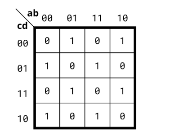

# 软件思维 vs 硬件思维

软件思维（指令式）：我们习惯按顺序思考。“如果有来电（ring=1），那么如果开了振动（vibrate_mode=1），马达转、铃声关；否则，铃声开、马达关。”

硬件思维（声明式）：硬件工程师通常“反着推”。我们不想怎么按顺序执行，我们只关心一件事：“在什么输入条件下，输出 ringer 会变成 1？在什么条件下，motor 会变成 1？”

# 人口计数3

“人口计数”电路用于统计输入向量中“1”的数量。为一个3位输入矢量构建一个人口计数电路。

```verilog
module top_module( 
    input [2:0] in,
    output [1:0] out );

    // 直接把三个 bit 加起来，综合工具会自动帮你处理进位和位宽
    assign out = in[0] + in[1] + in[2];

endmodule
```
**对于这种“计数”类的问题，直接用 + 让工具去生成加法器，通常是更优、更不容易出错的选择。**


# 把case、casez看成和module 一样的关键字

# 冒号 : 的两边不允许同时出现变量

因此采用+:（索引部分选择）

语法：vector[起始索引 +: 宽度]

含义：从“起始索引”开始，向高位（增加方向）提取“宽度”个 bit。

例如：起始索引是 sel * 4，宽度是 4，即 in[sel*4 +: 4]。


# 普通例化是不需要在外部套always的

# 全加器高级写法
assign {cout, sum} = a + b + cin;
使用“+”让综合工具帮你做综合

# 卡诺图化简

🗺️ 规则一：特殊的“格雷码”排列（相邻只差 1 位）
你看卡诺图边缘的数字：00, 01, 11, 10。
注意！它不是按 00, 01, 10, 11 顺序排的，而是格雷码（Gray Code）。

它的规律是：任何相邻的两个格子（上下或左右），只有一个变量发生了变化，其余变量保持不变。

比如 01 和 11 相邻，变化的是左边那一位；11 和 10 相邻，变化的是右边那一位。

头尾也是相邻的（画圈折叠）：最上面的 00 和最下面的 10 也是相邻的，最左边的列和最右边的列也是相邻的（像圆柱体一样卷起来）。

📦 规则二：分组必须是“2 的次幂”
在卡诺图中，你画的圈（无论是圈 1 还是圈 0），圈住的格子数量必须是 1, 2, 4, 8, 16...。

不能画包含 3 个格子的圈，也不能画包含 5 个格子的圈。

圈越大，化简后的表达式越短。 比如 4 个格子的圈能消掉 2 个变量，8 个格子的圈能消掉 3 个变量。

🔍 规则三：怎么“看”出一个化简后的表达式？（消元法）

圈 0 法（POS，和的乘积）：圈 0 写 POS 的时候，0 写原变量，1 写反变量，把它们加起来。
圈 1 法（SOP，乘积的和）：圈 1 写 SOP 的时候，1 写原变量，0 写反变量，把它们乘起来。


# 卡诺图失效



水平方向：没有任何两个 1 是挨着的（都是 1 和 0 交替）。

垂直方向：也没有任何两个 1 是上下相邻的。

折叠方向（首尾相接）：最上面和最下面的 1 也没有对齐。

意味着**没有任何 1 可以被合并化简**

在这 16 个格子里，输出为 1 的情况，恰好是当输入（a,b,c,d）中有奇数个 1（1个或3个1）的时候。

输出为 0 的情况，是当输入中有偶数个 1（0个、2个或4个1）的时候。

这正是数字电路中大名鼎鼎的 奇偶校验（Parity） 函数！

什么运算符生来就是为了处理奇偶校验的？没错，就是 异或（^）

# 常见错误：向量拼接的位宽与顺序

口诀：左高右低。

{A, B, C, D} 拼接后，A 占据最高位，D 占据最低位（[0] 位）。

避坑指南：如果题目要求 mux_in[3:0]，在写拼接符时，内心默念 3 -> 2 -> 1 -> 0，别把 0 放在最左边。