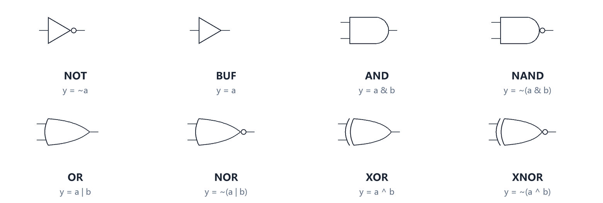
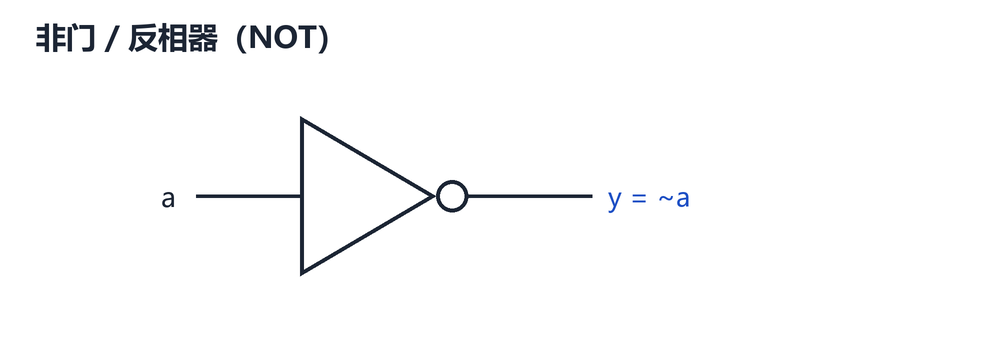
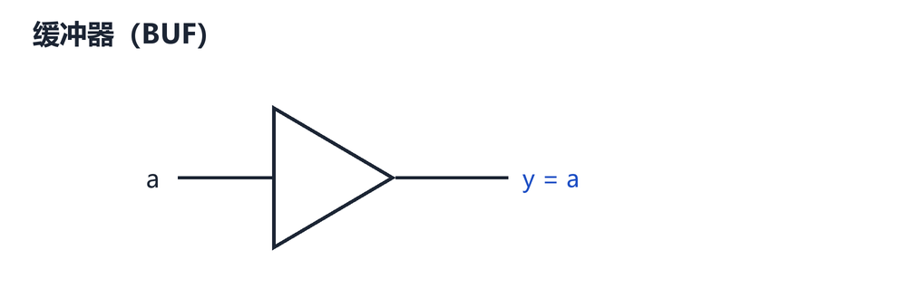
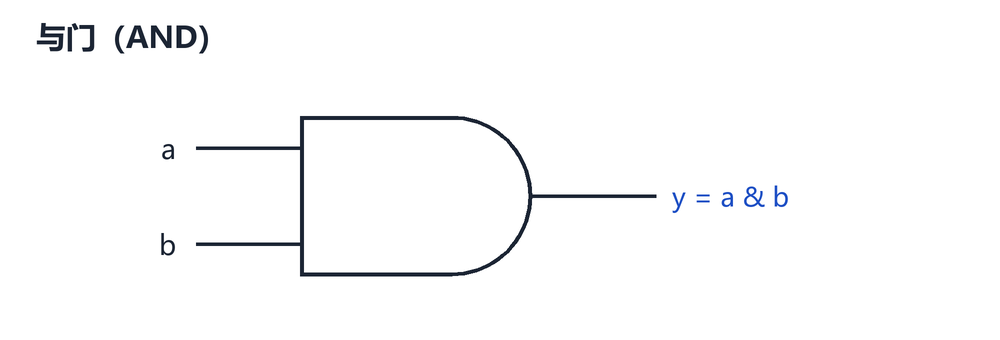
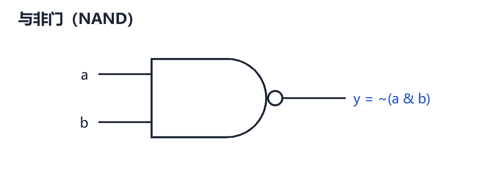
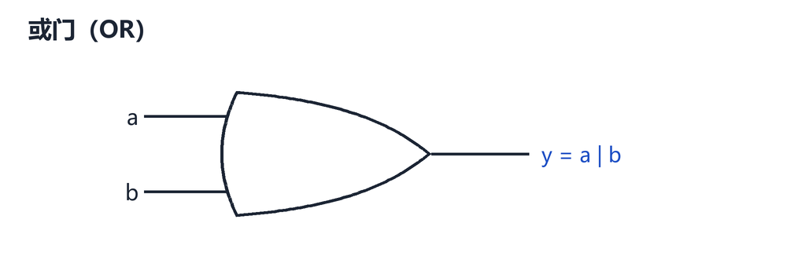
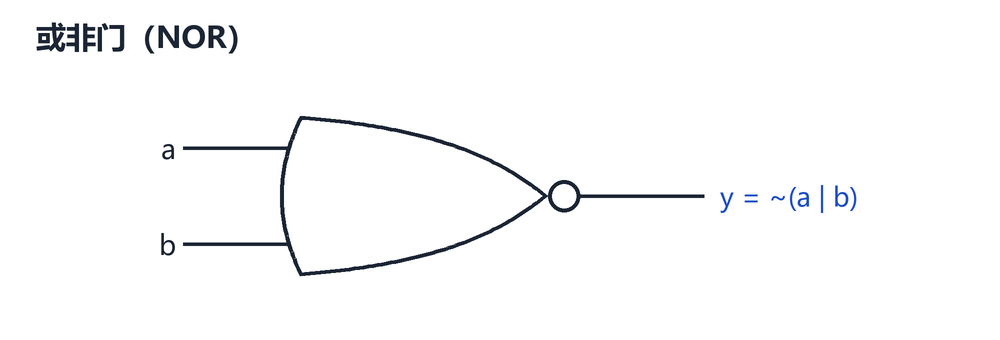
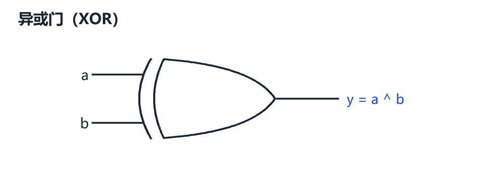
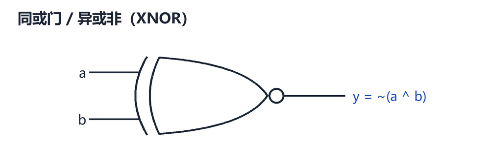
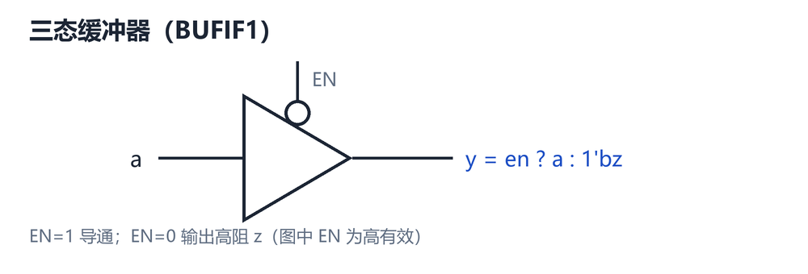

# 逻辑门：图形、真值表与 Verilog 实现

> 用途：把「门长什么样 → 真值表 → Verilog 怎么写 → 综合成什么」放在一起对照。
> 代码遵循 IEEE 1364-2005（Verilog-2005，兼容 Verilog-2001）可综合子集，测试平台为自检式写法，可直接在 iverilog / Vivado / QuestaSim 下运行。
> 图片位于同目录 `images/`，用 Markdown 预览（VS Code、Typora、GitHub）即可正常显示。

**目录**

0. 速查总表
1. 通用约定
2. 非门与缓冲器（NOT / BUF）
3. 与门、与非门（AND / NAND）
4. 或门、或非门（OR / NOR）
5. 异或门、同或门（XOR / XNOR）
6. 三态门与开关级原语
7. 多输入与向量位宽
8. 典型应用（加法器、校验、比较、格雷码）
9. 完整代码：`gates_all.v`
10. 自检测试平台与仿真
11. 综合视角
12. 常见错误清单
附录 A 运算符优先级
附录 B 中英术语对照

---

## 0 速查总表



| 门 | 布尔表达式 | Verilog 位运算符 | 门级原语 | 一句话记忆 |
| :--- | :--- | :--- | :--- | :--- |
| 非门 NOT | y = ā | `~a` | `not` | 取反 |
| 缓冲器 BUF | y = a | 直接赋值 | `buf` | 原样输出 |
| 与门 AND | y = a·b | `a & b` | `and` | 全 1 才 1 |
| 与非门 NAND | y = ¬(a·b) | `~(a & b)` | `nand` | 与门取反 |
| 或门 OR | y = a + b | `a \| b` | `or` | 有 1 就 1 |
| 或非门 NOR | y = ¬(a + b) | `~(a \| b)` | `nor` | 或门取反 |
| 异或门 XOR | y = a ⊕ b | `a ^ b` | `xor` | 不同为 1 |
| 同或门 XNOR | y = a ⊙ b = ¬(a ⊕ b) | `a ~^ b` 或 `a ^~ b` | `xnor` | 相同为 1 |

**双输入门的真值表（一张表看完全部）**

| a | b | AND | NAND | OR | NOR | XOR | XNOR |
| :-: | :-: | :-: | :-: | :-: | :-: | :-: | :-: |
| 0 | 0 | 0 | 1 | 0 | 1 | 0 | 1 |
| 0 | 1 | 0 | 1 | 1 | 0 | 1 | 0 |
| 1 | 0 | 0 | 1 | 1 | 0 | 1 | 0 |
| 1 | 1 | 1 | 0 | 1 | 0 | 0 | 1 |

> 记住三件事就够：**与门看"全 1"，或门看"有 1"，异或看"1 的个数是奇数"**（双输入时就是"两输入不同"）。NAND/NOR/XNOR 分别是 AND/OR/XOR 的取反。

---

## 1 通用约定

### 1.1 四种取值

| 值 | 含义 | 说明 |
| :--- | :--- | :--- |
| `0` | 逻辑低 | |
| `1` | 逻辑高 | |
| `x` | 未知 | 未初始化、多驱动冲突、时序违例等 |
| `z` | 高阻 | 三态门关闭、无驱动 |

真值表只讨论 0/1；x/z 的传播规则见 §5.5。**`x` 不等于"随便"，它会在仿真里一路传播，是查 bug 的线索。**

### 1.2 三种描述风格

同一个与门，可以有三种写法，综合结果几乎一样：

```verilog
// ① 结构描述：直接实例化门级原语（最接近电路图）
and u_and (y, a, b);

// ② 数据流描述：用运算符写布尔表达式（最常用）
assign y = a & b;

// ③ 行为描述：在 always 块里写逻辑（复杂组合逻辑更可读）
always @(*) y = a & b;   // 注意：y 必须声明为 reg
```

### 1.3 门级原语的写法规则

```verilog
原语名 [实例名] (输出, 输入1, 输入2, ...);
```

- **输出永远排第一个**，之后全是输入；
- 门原语**只支持位置连接**，不能写 `.a(a)` 这种命名端口；
- 实例名可省略（`and (y, a, b);` 合法），但建议写上，便于波形和报错定位；
- 原语端子是 **1 bit** 的，向量请用 `assign` 或 `generate` 展开（见 §7）；
- `buf` / `not` 允许**多个输出**：`not (y1, y2, a);`；
- `and` / `or` / `xor` 支持**多个输入**：`and (y, a, b, c, d);`，但只有一个输出。

> 门原语属于"结构描述"，一般只用于门级网表、教学和特殊建模（延时、驱动强度）。日常 RTL 用 `assign` 更清晰，综合器对两者的处理是一样的。

---

## 2 非门与缓冲器（NOT / BUF）

### 2.1 非门 NOT（反相器）



| a | y |
| :-: | :-: |
| 0 | 1 |
| 1 | 0 |

```verilog
// ① 门级原语
not u_not (y, a);

// ② 数据流
assign y = ~a;

// ③ 行为级（y 声明为 reg）
always @(*) y = ~a;
```

**要点**

- `~` 是按位取反：`~4'b1010 = 4'b0101`；`!` 是逻辑非，结果恒为 1 bit：`!4'b0000 = 1'b1`，`!4'b1010 = 1'b0`。
- 对 1 bit 信号 `~a` 和 `!a` 结果相同，**但在向量上完全不同**，这是最常见的混用错误之一。
- `not` 原语可以一次驱动多个输出，等价于扇出复制：

```verilog
not u_fan (y1, y2, a);   // y1 = y2 = ~a
```

### 2.2 缓冲器 BUF



| a | y |
| :-: | :-: |
| 0 | 0 |
| 1 | 1 |

```verilog
buf  u_buf (y, a);   // 门级原语
assign y  = a;       // 数据流，等价写法
```

**要点**

- 纯逻辑上 `buf` 就是一根线，综合器通常直接优化掉；
- 实际用途是**驱动增强、延时建模、隔离**（仿真时用 `#delay` 或驱动强度 `strong1/weak0`）；
- FPGA 的 IO 端会自动插入 IBUF/OBUF，不需要手写 `buf`。

---

## 3 与门、与非门（AND / NAND）

### 3.1 与门 AND



| a | b | y |
| :-: | :-: | :-: |
| 0 | 0 | 0 |
| 0 | 1 | 0 |
| 1 | 0 | 0 |
| 1 | 1 | 1 |

```verilog
// ① 门级原语
and u_and (y, a, b);

// ② 数据流
assign y = a & b;

// ③ 行为级
always @(*) y = a & b;
```

多输入（全部为 1 才输出 1）：

```verilog
and u_and4 (y, a, b, c, d);       // 原语写法
assign y = a & b & c & d;         // 等价写法
```

### 3.2 与非门 NAND



| a | b | y |
| :-: | :-: | :-: |
| 0 | 0 | 1 |
| 0 | 1 | 1 |
| 1 | 0 | 1 |
| 1 | 1 | 0 |

```verilog
nand u_nand (y, a, b);      // ① 门级原语
assign y = ~(a & b);        // ② 数据流（括号必须写！）
```

**要点**

- 写成 `assign y = ~a & b;` 得到的是 `(~a) & b`，因为 `~` 的优先级高于 `&`——这是新手最常踩的坑。
- 德摩根定律：`~(a & b) = ~a | ~b`，两种写法综合结果等价。
- NAND 是 CMOS 里最"便宜"的门（4 个管子），所以标准单元库和门级网表里到处都是 NAND。

---

## 4 或门、或非门（OR / NOR）

### 4.1 或门 OR



| a | b | y |
| :-: | :-: | :-: |
| 0 | 0 | 0 |
| 0 | 1 | 1 |
| 1 | 0 | 1 |
| 1 | 1 | 1 |

```verilog
or   u_or (y, a, b);     // ① 门级原语
assign y  = a | b;       // ② 数据流
always @(*) y = a | b;   // ③ 行为级
```

### 4.2 或非门 NOR



| a | b | y |
| :-: | :-: | :-: |
| 0 | 0 | 1 |
| 0 | 1 | 0 |
| 1 | 0 | 0 |
| 1 | 1 | 0 |

```verilog
nor  u_nor (y, a, b);    // ① 门级原语
assign y   = ~(a | b);   // ② 数据流（括号必须写）
```

**要点**

- `|` 按位或，`||` 逻辑或（结果 1 bit）；两者在向量上语义不同。
- 德摩根：`~(a | b) = ~a & ~b`。
- 或门在 CMOS 里通常由 `NOR + 反相器` 实现，所以 NOR 反而比 OR 更基础。

---

## 5 异或门、同或门（XOR / XNOR）

### 5.1 异或门 XOR



| a | b | y |
| :-: | :-: | :-: |
| 0 | 0 | 0 |
| 0 | 1 | 1 |
| 1 | 0 | 1 |
| 1 | 1 | 0 |

**异或的四种理解方式（都很重要）**

1. **不同为 1**：两输入电平不同时输出 1。
2. **模 2 加法（不进位加）**：`0+0=0, 0+1=1, 1+0=1, 1+1=0`，这正是半加器的"和位"。
3. **可控反相器**：`y = a ^ c`，`c=1` 时 `y = ~a`，`c=0` 时 `y = a`。
4. **奇偶检测器**：`^bus` 统计 1 的个数的奇偶性。

**代数性质**

| 性质 | 表达式 |
| :--- | :--- |
| 与 0 异或 | `a ^ 0 = a`（保持不变） |
| 与 1 异或 | `a ^ 1'b1 = ~a`（对 1 bit；整向量取反用 `~a`） |
| 自反 | `a ^ a = 0`，`a ^ ~a = 1` |
| 交换/结合 | `a ^ b = b ^ a`，`(a ^ b) ^ c = a ^ (b ^ c)` |
| 消去律 | `a ^ b ^ b = a`（校验、加解密的基础） |
| 与或形式 | 不能只用一个与门或一个或门实现，至少两级 |

```verilog
xor  u_xor (y, a, b);     // ① 门级原语
assign y   = a ^ b;       // ② 数据流（最常用）
```

**多输入异或**（奇数个 1 时输出 1）：

```verilog
xor    u_xor3 (y, a, b, c);    // 门级原语
assign y = a ^ b ^ c;          // 数据流，异或满足结合律，顺序无关
```

**缩减异或**（一元运算符，把整个向量逐位异或成 1 bit）：

```verilog
assign even_parity = ^data;    // 偶校验位：data 中 1 的个数为奇数时得 1
assign odd_parity  = ~^data;   // 奇校验位（= ^~data）
```

> 注意区分：`a ^ b` 里的 `^` 是**二元按位**运算符；`^data` 里的 `^` 是**一元缩减**运算符，结果只有 1 bit。`^4'b1010` 的结果是 `1'b0`，不是按位取反。

### 5.2 同或门 XNOR



| a | b | y |
| :-: | :-: | :-: |
| 0 | 0 | 1 |
| 0 | 1 | 0 |
| 1 | 0 | 0 |
| 1 | 1 | 1 |

```verilog
xnor u_xnor (y, a, b);    // ① 门级原语
assign y = ~(a ^ b);      // ② 数据流
assign y = a ~^ b;        // ③ 二元同或运算符
assign y = a ^~ b;        // ④ 同上，两种写法完全等价
```

**要点**

- 对 1 bit 而言，**同或就是"相等判断"**：`a ~^ b` 与 `a == b` 结果一致（都是 0/1 时）。
- 缩减同或：`~^data` 或 `^~data`，得到"1 的个数为偶数"的标志，即奇校验位。
- XNOR 不是独立的标准单元，综合时一般是 `XOR + INV`。

### 5.3 异或的典型变形

```verilog
// 可控反相器 / 按掩码翻转
assign y = a ^ {W{inv}};     // inv=1：整体取反；inv=0：保持
assign y = a ^ mask;         // mask 中为 1 的位翻转

// 条件取反的另一种写法（等价，但可读性差，了解即可）
assign y = inv ? ~a : a;

// 用异或做相等比较（见 §8.3）
assign eq = ~|(a ^ b);       // 所有位都相同 -> 1
```

### 5.4 用与或实现异或（理解"为什么异或更贵"）

```verilog
assign y = (~a & b) | (a & ~b);   // 2 个 AND + 1 个 OR + 2 个 INV
```

在 CMOS 标准单元里，`NAND2` 约 4 个管子，而 `XOR2` 约 12 个管子（静态 CMOS）或 8 个管子（传输门）。所以：

- ASIC 里异或是"贵门"，能用与或替代且不影响时序时可替换；
- FPGA 里一个 LUT 就能实现任意 4/6 输入函数，`^` 和 `&` 的代价一样（都是 1 个 LUT），**不需要为省异或而改写逻辑**。

### 5.5 x / z 的传播规则（仿真必看）

```text
0 & x = 0        1 & x = x        与门可以被 0 屏蔽
0 | x = x        1 | x = 1        或门可以被 1 屏蔽
0 ^ x = x        1 ^ x = x        异或没有任何屏蔽能力
x ^ x = x        （注意：不是 0，两个 x 未必同值）
~x    = x        1 ^ z = x        0 & z = 0        0 | z = x
```

> 结论：只要参与运算的某一位是 x，异或结果就是 x；而 `&` 遇到 0、`|` 遇到 1 会被"短路"掉，仍然能给出确定值。仿真里出现 x 时，顺着异或链往下找往往能定位到源头。

---

## 6 三态门与开关级原语

### 6.1 三态缓冲器



| en | a | y |
| :-: | :-: | :-: |
| 0 | 0 | z |
| 0 | 1 | z |
| 1 | 0 | 0 |
| 1 | 1 | 1 |

```verilog
bufif1 u_tri (y, a, en);            // en=1 导通，en=0 输出高阻 z
bufif0 u_tri_n (y, a, en);          // en=0 导通（低有效）
notif1 u_tri_inv (y, a, en);        // 导通时反相输出

assign y = en ? a : 1'bz;           // 等价的连续赋值写法
```

**要点**

- 三态门的输出 `z` 表示"这根线现在没人驱动"，常用于**双向总线**：多路输出挂同一根线，靠 en 互斥选通。
- 必须保证**同一时刻最多一个驱动**，否则一个驱 0 一个驱 1 会得到 `x`（真实电路里是短路，会烧片）。
- 读回总线值时用 `=== 1'bz` 判断高阻，不能用 `==`。
- **可综合性**：
  - ASIC：顶层 IO 的双向总线可以用，综合成三态单元；
  - FPGA：内部**没有**三态资源，`1'bz` 只会被综合成 MUX 或者直接报错；只有 IO 处的 `IOBUF` 才是真三态。
  - 结论：**片内互连永远用 MUX，不要用三态。**

### 6.2 开关级原语（仅仿真 / 定制电路）

```verilog
nmos  (out, data, ctrl);        // ctrl=1 时导通
pmos  (out, data, ctrl);        // ctrl=0 时导通
cmos  (out, data, nctrl, pctrl); // 传输门
tran  (net1, net2);             // 双向导通
```

这些是晶体管级建模，**不可综合**（综合器会直接忽略或报错），只用于模拟电路行为、传输门逻辑或标准单元内部建模。日常 RTL 不要使用。

---

## 7 多输入与向量位宽

### 7.1 向量按位运算（推荐）

```verilog
module gates_vec #(
    parameter W = 8
) (
    input  wire [W-1:0] a,
    input  wire [W-1:0] b,
    output wire [W-1:0] y_not,
    output wire [W-1:0] y_and,
    output wire [W-1:0] y_or,
    output wire [W-1:0] y_xor,
    output wire [W-1:0] y_nand,
    output wire [W-1:0] y_nor,
    output wire [W-1:0] y_xnor
);

    assign y_not  = ~a;
    assign y_and  = a  &  b;
    assign y_or   = a  |  b;
    assign y_xor  = a  ^  b;
    assign y_nand = ~(a & b);        // 括号不可省
    assign y_nor  = ~(a | b);
    assign y_xnor = ~(a ^ b);        // 等价于 a ~^ b

endmodule
```

对向量，`&` `|` `^` 都是**逐位独立**运算，`W` 位就是 `W` 个门并行，天然可参数化。

### 7.2 用 generate 展开门级原语

门原语端子是 1 bit 的，要在向量上用原语，需要 `generate` 展开（放进 §7.1 的模块体内）：

```verilog
genvar i;
generate
    for (i = 0; i < W; i = i + 1) begin : g_and
        and u_and (y_and[i], a[i], b[i]);
    end
endgenerate
```

这样写出来的是真正的 `W` 个与门实例，网表里能看到。普通 RTL 里没必要，直接用 §7.1 的 `assign` 即可。

### 7.3 位宽陷阱

```verilog
wire [7:0] a, b;
wire [3:0] y;

assign y = a ^ b;          // ✗ 8 位结果赋给 4 位 y，高 4 位被静默丢弃
assign y = (a ^ b)[3:0];   // ✗ Verilog-2001 不允许对表达式位选（SystemVerilog 才行）

wire [7:0] t = a ^ b;      // ✓ 先算完整结果
assign y = t[3:0];         // ✓ 再明确截取
```

常量位宽的影响：

| 写法（a 为 8 位） | 位宽行为 | 结论 |
| :--- | :--- | :--- |
| `a ^ 1'b1` | 1 位常量，按 a 的位宽零扩展 | ✓ |
| `a ^ 8'hFF` | 8 位常量，与 a 对齐 | ✓ |
| `a ^ 1` | 无位宽常量按 **32 位** 参与运算，再截断 | ✗ 易出错 |

**规则：常量一律写全位宽**（`1'b1`、`8'hFF`、`4'd9`）。无位宽常量默认 32 位，在窄位宽运算里会悄悄改变结果。

---

## 8 典型应用

### 8.1 半加器与全加器（异或最经典的应用）

半加器：`sum = a ^ b`，`cout = a & b`。

| a | b | cout | sum |
| :-: | :-: | :-: | :-: |
| 0 | 0 | 0 | 0 |
| 0 | 1 | 0 | 1 |
| 1 | 0 | 0 | 1 |
| 1 | 1 | 1 | 0 |

```verilog
module half_adder (
    input  wire a,
    input  wire b,
    output wire sum,
    output wire cout
);
    assign sum  = a ^ b;   // 和位：不进位加
    assign cout = a & b;   // 进位
endmodule
```

全加器：两个半加器 + 一个或门。

```verilog
module full_adder (
    input  wire a,
    input  wire b,
    input  wire cin,
    output wire sum,
    output wire cout
);
    wire s1 = a ^ b;                    // 第一次半加
    assign sum  = s1 ^ cin;             // 第二次半加
    assign cout = (a & b) | (s1 & cin); // 两个进位取或
endmodule
```

> 把 `cout` 写成三输入的"多数表决" `(a & b) | (b & cin) | (a & cin)` 也等价，而且这种形式更容易映射到进位链。

### 8.2 奇偶校验

```verilog
wire [7:0] data;

assign even_bit = ^data;    // 偶校验位：附加后 1 的总个数为偶数
assign odd_bit  = ~^data;   // 奇校验位
```

`^data` 就是"1 的个数 mod 2"，硬件上是一棵异或树，`n` 位需要 `n-1` 个异或门。串行链路、存储 ECC、UART 校验都用它。

### 8.3 相等比较

```verilog
// 两个等宽向量比较
assign eq = ~|(a ^ b);     // 每一位都相同 -> 1（异或全 0，再缩减或非）
assign ne =  |(a ^ b);     // 有任意一位不同 -> 1

// 与常量比较
assign is_10 = ~|(d ^ 4'b1010);   // 等价于 (d == 4'b1010)
```

`==` 在综合时会被展开成"异或树 + 或非"，理解这一点有助于判断比较器的面积与时序。

### 8.4 二进制与格雷码互转

```verilog
// 二进制 -> 格雷码
assign gray = bin ^ (bin >> 1);

// 格雷码 -> 二进制（前缀异或）
integer i;
always @(*) begin
    bin[W-1] = gray[W-1];
    for (i = W-2; i >= 0; i = i - 1)
        bin[i] = bin[i+1] ^ gray[i];
end
```

格雷码相邻码字只差 1 位，跨时钟域传递计数器值时用它可以把多位同时跳变的风险降到最低。

### 8.5 可控反相与条件取反

```verilog
assign y = a ^ {W{inv}};      // inv=1 取反，inv=0 保持（按位）
assign y = a ^ mask;          // 按掩码翻转，常用于写 1 清零、CRC 更新
```

### 8.6 不用临时变量交换两个数（原理，硬件里没意义）

```verilog
a = a ^ b;
b = a ^ b;      // b = (a^b)^b = a
a = a ^ b;      // a = (a^b)^a = b
```

这是软件里的技巧，能省一个临时变量。**在硬件里它综合出三个异或门，反而比直接连线更费资源**，只作为理解"自反律"的例子。

---

## 9 完整代码：`gates_all.v`

把所有门放在一个模块里，方便一次仿真对照波形。同目录下的 `gates_all.v` 就是这段代码，可直接拿来编译。

```verilog
`timescale 1ns/1ps

module gates_all (
    input  wire       a,
    input  wire       b,
    input  wire       c,
    input  wire [3:0] d,
    output wire       y_not,
    output wire       y_buf,
    output wire       y_and,
    output wire       y_nand,
    output wire       y_or,
    output wire       y_nor,
    output wire       y_xor,
    output wire       y_xnor,
    output wire       y_xor3,
    output wire       y_parity,
    output wire       y_eq
);

    // ---------------- ① 门级原语（结构描述）----------------
    not  u_not  (y_not,  a);
    buf  u_buf  (y_buf,  a);
    and  u_and  (y_and,  a, b);
    nand u_nand (y_nand, a, b);
    or   u_or   (y_or,   a, b);
    nor  u_nor  (y_nor,  a, b);
    xor  u_xor  (y_xor,  a, b);
    xnor u_xnor (y_xnor, a, b);
    xor  u_xor3 (y_xor3, a, b, c);        // 多输入异或：奇数个 1 出 1

    // ---------------- ② 数据流描述（assign）----------------
    assign y_parity = ^d;                 // 缩减异或：偶校验位
    assign y_eq     = ~|(d ^ 4'b1010);    // 逐位异或后缩减或非：d == 1010 ?

endmodule
```

**说明**

- `y_xor` 与 `y_xnor` 分别验证二元异或/同或；`y_xor3` 验证多输入异或；
- `y_parity` 和 `y_eq` 演示缩减运算符 `^`、`~|` 的用法；
- 如果工具支持，可以在文件开头加 `` `default_nettype none `` 强制检查漏声明的 wire，文件结尾再恢复 `` `default_nettype wire ``。

---

## 10 自检测试平台与仿真

### 10.1 `tb_gates_all.v`

```verilog
`timescale 1ns/1ps

module tb_gates_all;

    reg  a, b, c;
    reg  [3:0] d;

    wire y_not, y_buf, y_and, y_nand, y_or, y_nor;
    wire y_xor, y_xnor, y_xor3, y_parity, y_eq;

    // 期望值（黄金模型）
    reg  e_not, e_buf, e_and, e_nand, e_or, e_nor;
    reg  e_xor, e_xnor, e_xor3, e_parity, e_eq;

    integer i, errors;

    gates_all dut (
        .a(a), .b(b), .c(c), .d(d),
        .y_not(y_not), .y_buf(y_buf), .y_and(y_and), .y_nand(y_nand),
        .y_or(y_or), .y_nor(y_nor), .y_xor(y_xor), .y_xnor(y_xnor),
        .y_xor3(y_xor3), .y_parity(y_parity), .y_eq(y_eq)
    );

    // 用运算符直接算期望值
    always @(*) begin
        e_not    = ~a;
        e_buf    =  a;
        e_and    =  a & b;
        e_nand   = ~(a & b);
        e_or     =  a | b;
        e_nor    = ~(a | b);
        e_xor    =  a ^ b;
        e_xnor   =  a ~^ b;
        e_xor3   =  a ^ b ^ c;
        e_parity = ^d;
        e_eq     = (d == 4'b1010);
    end

    // 自检任务：把 11 个输出拼成向量，一次比较完
    task check_all;
        begin
            if ({y_not, y_buf, y_and, y_nand, y_or, y_nor,
                 y_xor, y_xnor, y_xor3, y_parity, y_eq}
                !==
                {e_not, e_buf, e_and, e_nand, e_or, e_nor,
                 e_xor, e_xnor, e_xor3, e_parity, e_eq}) begin
                errors = errors + 1;
                $display("  [FAIL] @%0t  a=%b b=%b c=%b d=%04b", $time, a, b, c, d);
                $display("         got %b %b %b %b %b %b %b %b %b %b %b",
                         y_not, y_buf, y_and, y_nand, y_or, y_nor,
                         y_xor, y_xnor, y_xor3, y_parity, y_eq);
                $display("         exp %b %b %b %b %b %b %b %b %b %b %b",
                         e_not, e_buf, e_and, e_nand, e_or, e_nor,
                         e_xor, e_xnor, e_xor3, e_parity, e_eq);
            end
        end
    endtask

    // 波形
    initial begin
        $dumpfile("tb_gates_all.vcd");
        $dumpvars(0, tb_gates_all);
    end

    initial begin
        errors = 0;
        $display("============================================================");
        $display(" a b c |  d   | not buf and nand or nor xor xnor xor3 par eq");
        $display("============================================================");

        // 穷举 8 组输入
        for (i = 0; i < 8; i = i + 1) begin
            {a, b, c} = i[2:0];
            d = i[2:0];
            #10;
            $display(" %b %b %b | %04b | %b %b  %b   %b   %b  %b   %b  %b   %b   %b  %b",
                     a, b, c, d, y_not, y_buf, y_and, y_nand, y_or, y_nor,
                     y_xor, y_xnor, y_xor3, y_parity, y_eq);
            check_all;
        end

        // 定向测试：d = 1010 时相等标志应为 1
        d = 4'b1010;
        #10;
        $display("------------------------------------------------------------");
        $display("directed: d=%04b -> parity=%b eq=%b", d, y_parity, y_eq);
        check_all;

        // 4 态演示：a = x 时各门如何传播
        a = 1'bx; b = 1'b1; c = 1'b0;
        #10;
        $display("X 传播: a=x b=1 -> and=%b or=%b xor=%b nand=%b xnor=%b",
                 y_and, y_or, y_xor, y_nand, y_xnor);
        $display("------------------------------------------------------------");

        if (errors == 0) $display("PASS: 全部向量通过");
        else             $display("FAIL: %0d 处不一致", errors);
        $finish;
    end

endmodule
```

### 10.2 预期输出

```text
============================================================
 a b c |  d   | not buf and nand or nor xor xnor xor3 par eq
============================================================
 0 0 0 | 0000 | 1 0  0   1   0  1   0  1   0   0  0
 0 0 1 | 0001 | 1 0  0   1   0  1   0  1   1   1  0
 0 1 0 | 0010 | 1 0  0   1   1  0   1  0   1   1  0
 0 1 1 | 0011 | 1 0  0   1   1  0   1  0   0   0  0
 1 0 0 | 0100 | 0 1  0   1   1  0   1  0   1   1  0
 1 0 1 | 0101 | 0 1  0   1   1  0   1  0   0   0  0
 1 1 0 | 0110 | 0 1  1   0   1  0   0  1   0   0  0
 1 1 1 | 0111 | 0 1  1   0   1  0   0  1   1   1  0
------------------------------------------------------------
directed: d=1010 -> parity=0 eq=1
X 传播: a=x b=1 -> and=x or=1 xor=x nand=x xnor=x
------------------------------------------------------------
PASS: 全部向量通过
```

对照读法：

- `and` / `nand` 只在 `a=b=1` 那一行翻转；
- `xor` / `xnor` 在 `010`、`100` 两行不同；
- `xor3` 与 `par` 同步变化（因为 `d = {1'b0, a, b, c}`，奇偶性与三输入异或一致）；
- 前半段 `eq` 恒为 0，定向测试里 `d=1010` 才变 1；
- `x` 传播那一行验证了 §5.5：`and=x`、`or=1`（被 1 屏蔽）、`xor=x`。

### 10.3 运行方式

同目录已放好 `gates_all.v` 和 `tb_gates_all.v`，直接开命令行运行即可。

**iverilog（Windows / Linux 通用）**

```bash
iverilog -o gates.vvp gates_all.v tb_gates_all.v
vvp gates.vvp
gtkwave tb_gates_all.vcd        # 可选：看波形
```

**Vivado**

1. 新建工程，把 `gates_all.v`、`tb_gates_all.v` 都添加为 **Simulation Sources**；
2. `tb_gates_all` 右键 → *Set as Top*；
3. Flow → *Run Simulation* → *Run Behavioral Simulation*；
4. 在 Tcl Console 里能看到 `PASS: 全部向量通过`。

**QuestaSim / ModelSim**

```tcl
vlib work
vlog gates_all.v tb_gates_all.v
vsim -c tb_gates_all -do "run -all; quit"
```

---

## 11 综合视角

| 关注点 | 说明 |
| :--- | :--- |
| 三种写法等价 | `and u(y,a,b)`、`assign y=a&b`、`always @(*) y=a&b` 综合出的电路基本一致 |
| 延时被忽略 | 门原语里的 `#5` 只对仿真有效，综合器直接丢弃；真实时序靠 STA |
| 驱动强度被忽略 | `strong1/weak0` 只用于仿真建模总线竞争 |
| `buf` 会被优化 | 纯连线在综合时被合并，除非在 IO 边界 |
| 三态只能到 IO | FPGA 内部无三态资源；片内选择一律用 MUX（`?:` / `case`） |
| 异或的代价 | ASIC：XOR2 约 12 管 > NAND2 的 4 管；FPGA：都是 1 个 LUT，无需特别处理 |
| 组合环 | `assign a = ~a;` 这类反馈会报错或综合出振荡结构，RTL 里禁止 |
| 未用信号被裁掉 | 输出没接到端口的逻辑会被优化掉，仿真"有波形"不代表综合后还在 |

**三条红线**（出现任意一条，综合结果就不是你想要的电路）：

1. **组合逻辑成环**——没有寄存器的反馈；
2. **多驱动**——同一根 wire 被两个 `assign` 或多个 always 驱动；
3. **意外锁存器**——组合 `always` 块里 `if` 缺 `else`、`case` 缺 `default`。

---

## 12 常见错误清单

| # | 场景 | 错误写法 | 正确写法 | 原因 |
| :-: | :--- | :--- | :--- | :--- |
| 1 | 想写 NAND | `assign y = ~a & b;` | `assign y = ~(a & b);` | `~` 优先级最高，先取反 a |
| 2 | 用逻辑与做位运算 | `assign y = a && b;`（向量） | `assign y = a & b;` | `&&` 只输出 1 bit |
| 3 | 常量不带位宽 | `a ^ 1` | `a ^ 1'b1` | 无位宽常量是 32 位，隐式扩展 |
| 4 | 以为 `^a` 是按位取反 | `y = ^a;`（a 为向量） | `y = ~a;` | 一元 `^` 是缩减异或，结果 1 bit |
| 5 | 比较 x / z | `if (a == 1'bx)` | `if (a === 1'bx)` | `==` 遇 x 结果为 x，条件为假 |
| 6 | 内部用三态做选择 | `assign y = en ? a : 1'bz;` | `assign y = en ? a : b;` | FPGA 内部无三态资源 |
| 7 | 组合块漏分支 | `always @(*) if (sel) y = a;` | 补 `else y = b;` | 缺 else 会综合出锁存器 |
| 8 | 门原语命名端口 | `and u(.y(y), .a(a), .b(b));` | `and u(y, a, b);` | 原语只支持位置连接 |
| 9 | 位宽截断 | `wire [3:0] y = a ^ b;`（a、b 为 8 位） | 先 `wire [7:0] t = a ^ b;` 再 `assign y = t[3:0];` | 高位被静默丢弃 |
| 10 | 把 `~` 与 `!` 混用 | `y = !data;`（data 为向量） | `y = ~data;` | `!` 只判断"是否为 0" |
| 11 | 多驱动 | 两个 `assign` 驱动同一 wire | 用 MUX 合并 | 产生 x 或综合报错 |
| 12 | always 里用 assign | `always @(*) assign y = a;` | `always @(*) y = a;` | 语法错误 |

---

## 附录 A 运算符优先级（高 → 低）

| 优先级 | 运算符 | 说明 |
| :-: | :--- | :--- |
| 1 | `+ - ! ~ & ~& \| ~\| ^ ~^` | 一元运算符（含所有缩减运算符） |
| 2 | `**` | 幂 |
| 3 | `* / %` | 乘除取模 |
| 4 | `+ -` | 二元加减 |
| 5 | `<< >> <<< >>>` | 移位 |
| 6 | `< <= > >=` | 关系 |
| 7 | `== != === !==` | 相等 |
| 8 | `&` | 按位与 |
| 9 | `^ ^~` | 按位异或 / 同或 |
| 10 | `\|` | 按位或 |
| 11 | `&&` | 逻辑与 |
| 12 | `\|\|` | 逻辑或 |
| 13 | `?:` | 条件运算符（右结合） |

**实用结论**

- `~` 永远最先算，所以 `~a & b` = `(~a) & b`，取反整个表达式必须加括号；
- `&` 高于 `^` 高于 `|`，所以 `a & b ^ c | d` = `((a & b) ^ c) | d`；
- 拿不准就加括号——括号不产生硬件，只影响可读性。

## 附录 B 中英术语对照

| 中文 | 英文 | 中文 | 英文 |
| :--- | :--- | :--- | :--- |
| 门 | gate | 三态 | tri-state |
| 真值表 | truth table | 高阻 | high-Z |
| 与门 | AND gate | 原语 | primitive |
| 或门 | OR gate | 结构描述 | structural |
| 非门 / 反相器 | NOT / inverter | 数据流描述 | dataflow |
| 与非门 | NAND | 行为描述 | behavioral |
| 或非门 | NOR | 可综合 | synthesizable |
| 异或门 | XOR (exclusive OR) | 综合 | synthesis |
| 同或门 | XNOR (equivalence) | 锁存器 | latch |
| 缓冲器 | buffer | 缩减运算符 | reduction operator |
| 扇出 | fan-out | 驱动强度 | drive strength |
| 位宽 | bit width | 延迟 | delay |

---

**一句话总结**：`&` `|` `^` `~` 四个位运算符 + `~( )` 的括号，就能写出全部门；异或的独特之处在于它既是"不同检测"、又是"模 2 加法"、还是"可控反相器"，所以加法器、校验、比较、格雷码、加解密里都少不了它。
